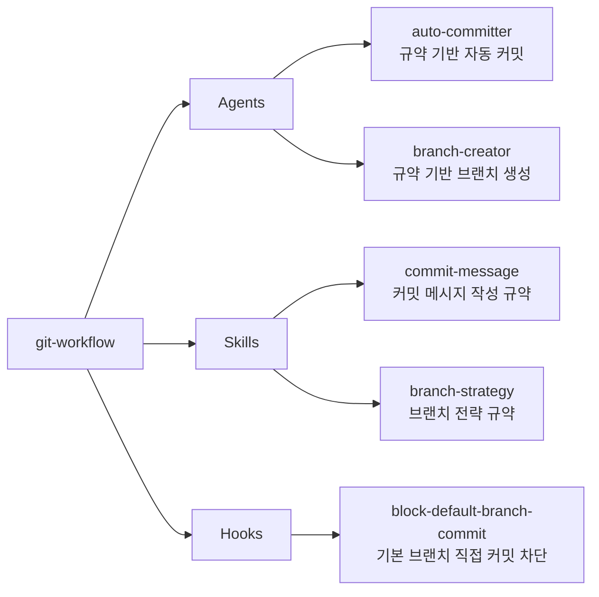

# git-workflow

로컬 Git 워크플로우 규약(커밋 메시지, 브랜치 네이밍)과 기본 브랜치 직접 커밋 차단 훅을 제공하는 플러그인

## 💁 개요



## 💾 설치 방법

이 플러그인을 사용하려는 프로젝트의 루트 디렉토리에서 아래 명령어를 실행합니다.

### GitHub에서 추가

```bash
# 마켓플레이스 등록
/plugin marketplace add iamhoonse-dev/hoonse-claude-plugins

# 플러그인 설치
/plugin install git-workflow@hoonse-claude-plugins
```

### 로컬 경로에서 추가

```bash
# 마켓플레이스 등록
/plugin marketplace add /path/to/hoonse-claude-plugins

# 플러그인 설치
/plugin install git-workflow@hoonse-claude-plugins
```

## 🧑‍💻 사용 예시

### 📖 Skills

Skills는 `/git-workflow:<skill-name>` 형태로 호출합니다. 플러그인 스킬은 네임스페이스(`<plugin-name>:`)를 생략할 수 없습니다.

#### commit-message

`commit-message` 스킬은 `user-invocable: false`로 설정된 지침형 스킬입니다. Claude가 커밋 메시지를 작성할 때 자동으로 참조하며, 직접 호출하지 않아도 됩니다.

```
/git-workflow:commit-message
```

### 🤖 Agents

Agents는 대화 중 관련 요청 시 자동으로 활성화되거나, 직접 요청할 수 있습니다.

#### auto-committer

##### with plugin namespace

```
@git-workflow:auto-committer 변경사항 커밋해줘
```

##### without plugin namespace

```
변경사항 커밋해줘
```

#### branch-creator

##### with plugin namespace

```
@git-workflow:branch-creator 브랜치 만들어줘
```

##### without plugin namespace

```
브랜치 만들어줘
```

## 🛠️ 기능

### 📖 Skills

| 이름 | 타입 | 설명 |
|------|------|------|
| commit-message | 지침형 | Conventional Commits v1.0.0 기반의 **범용 기본** 커밋 메시지 규약입니다. 프로젝트 규약이 없을 때 적용됩니다. |
| branch-strategy | 지침형 | trunk-based development 기반의 **범용 기본** 브랜치 전략입니다. 프로젝트 규약이 없을 때 적용됩니다. |

### 🤖 Agents

| 이름 | 설명 |
|------|------|
| auto-committer | 스테이징된 변경 사항을 분석하고 프로젝트의 커밋 메시지 규약에 따라 메시지를 작성한 뒤 자동으로 커밋합니다. |
| branch-creator | 프로젝트의 브랜치 전략 규약을 읽고, 사용자의 작업 의도에 맞는 브랜치를 기본 브랜치에서 생성합니다. |

### 🪝 Hooks

| 이벤트 | 스크립트 | 설명 |
|--------|----------|------|
| PreToolUse (Bash) | `block-default-branch-commit.sh` | `git commit` 명령이 기본 브랜치(`main`, `master`, 원격 HEAD 가 가리키는 브랜치)에서 실행되면 차단합니다. |

- `git -C <dir> commit`, 맨 앞의 `cd <dir> && git commit` 도 대상 레포를 판별해 검사합니다.
- 커밋이 하나도 없는 빈 레포의 **첫 커밋은 허용**합니다.
- 사용자가 기본 브랜치 커밋을 명시적으로 허락한 경우, 명령 앞에 `GIT_WORKFLOW_ALLOW_DEFAULT_BRANCH_COMMIT=1` 을 붙이면 통과합니다.
- `jq` 가 필요합니다. 없으면 검사하지 않고 통과시킵니다.

## 🔧 커스터마이징

### 규약 오버라이딩

플러그인의 `commit-message`, `branch-strategy` 스킬은 어느 프로젝트에서나 쓸 수 있는 **범용 기본 규약**입니다.
에이전트는 아래 순서로 규약을 찾고, 처음 발견한 것을 따릅니다.

| 순서 | 위치 | 예 |
|------|------|----|
| 1 | 프로젝트 스킬 `.claude/skills/<skill>/SKILL.md` | 프로젝트 맞춤 규약 전체 |
| 2 | `CLAUDE.md` / `AGENTS.md` 의 관련 규칙 | "커밋은 `<type>(<package>): <요약>`" |
| 3 | 기존 기록 | 커밋은 `git log`, 브랜치는 `git branch -a` 의 일관된 형식 |
| 4 | 플러그인 기본 규약 | 이 플러그인의 스킬 |

```
your-project/
├── .claude/
│   └── skills/
│       ├── commit-message/
│       │   └── SKILL.md    ← 프로젝트 맞춤 커밋 규약
│       └── branch-strategy/
│           └── SKILL.md    ← 프로젝트 맞춤 브랜치 전략
└── ...
```

간단한 규칙이면 `CLAUDE.md` / `AGENTS.md` 에 적는 것으로 충분하고, 규칙이 길거나 예시가 많으면 프로젝트 스킬로 분리하는 것을 권장합니다.
이 마켓플레이스 레포도 [`.claude/skills/`](../../.claude/skills) 에 자체 규약을 두고 있습니다.

## ⚖️ 라이선스

[MIT](LICENSE)
